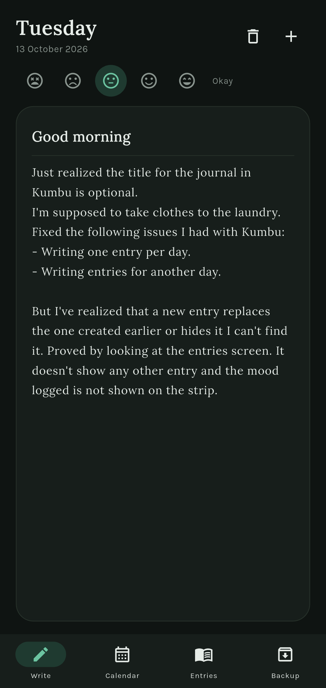
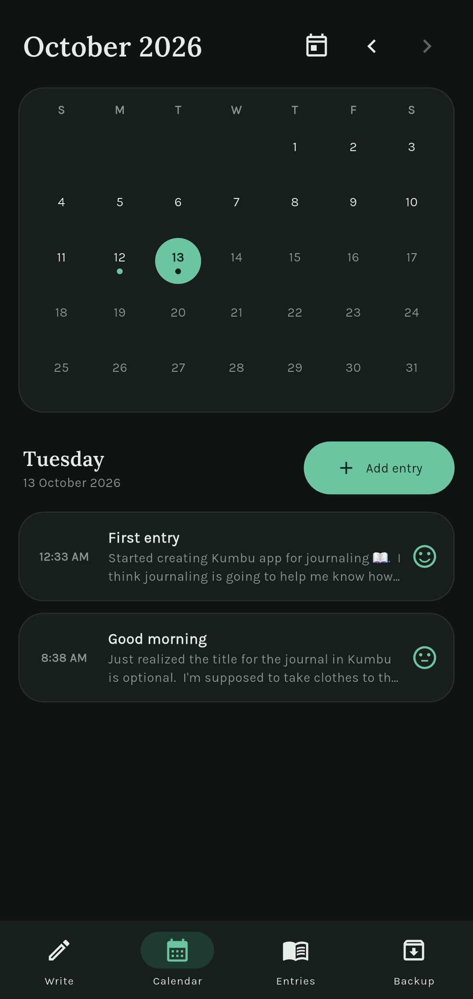
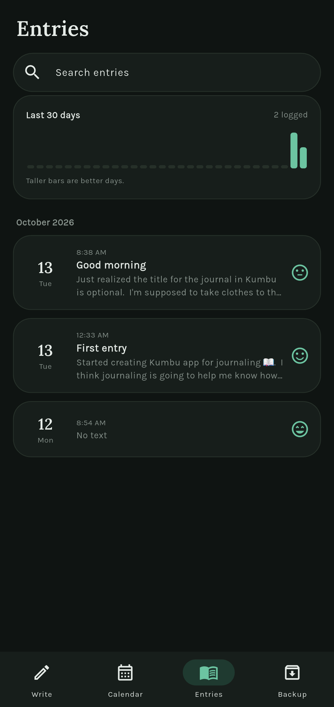
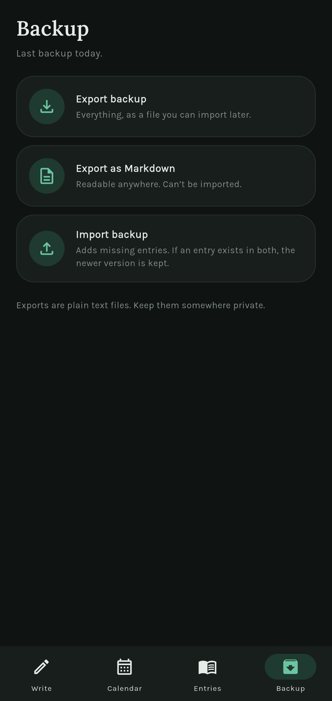

# Kumbu

A private, offline journal for Android. Your entries live only on your phone, behind your fingerprint or screen lock.


*Kumbu is short for* kumbukumbu, *the Swahili word for memories.*

## Screenshots

<table>
  <tr>
    <td align="center"><br><sub>Write</sub></td>
    <td align="center"><br><sub>Calendar</sub></td>
    <td align="center"><br><sub>Entries</sub></td>
    <td align="center"><br><sub>Backup</sub></td>
  </tr>
</table>

## Why I built it

I wanted a journal that works without a connection, never sends my writing to a server, and can't be opened by whoever happens to pick up my phone. Kumbu is deliberately small: one local database, no accounts, and no sync.

## Features

- **Biometric lock.** Opens with your fingerprint, face, or screen lock, and locks again whenever you leave the app.
- **Private by default.** Everything is stored in a local SQLite database. The app hides its content in Android's recent-apps screen, which also blocks screenshots.
- **Offline writing with autosave.** Saves a moment after you stop typing, and again when you switch away or close the screen. It never creates empty entries.
- **Several entries per day.** Start another entry for today with one tap.
- **Calendar.** Browse by month, see which days have entries, and add an entry for any past day.
- **Entries list.** Newest first, grouped by month, with search across titles and text.
- **Mood tracking.** A five-point mood per entry, and a 30-day strip that shows the pattern at a glance.
- **Delete with confirmation.**
- **Backup and restore.** Export everything as JSON and import it again, or export a readable Markdown file. A badge on the Backup tab appears when a backup is overdue.
- **Light and dark themes** that follow the system setting.

## Design

- **Type:** Lora for writing and headings, Karla for the interface.
- **Colour:** a cool off-white and white cards with a deep green accent (`#2F6F55`). Every colour lives in one class in `lib/theme.dart`.
- **Layout:** four tabs (Write, Calendar, Entries, Backup) in a bottom navigation bar that hides while the keyboard is open.

## Under the hood

- **Local-first data.** One `entries` table in SQLite, accessed through a single class (`JournalDb`). Entries have UUID ids and are filed under the writer's local calendar date (`yyyy-MM-dd`), so a late-night entry never lands on the wrong day because of time zones.
- **Autosave.** Edits are debounced by 800 ms and also flushed when the app goes to the background or the screen is disposed. The editor reads its text before any `await`, so closing the screen can't lose the last edit.
- **App lock.** `LockGate` sits above the `Navigator`, so it covers every screen. It guards against the system biometric prompt triggering lifecycle events that would otherwise re-open the prompt in a loop.
- **Schema self-repair.** Early versions allowed one entry per day through a `UNIQUE` constraint. SQLite can't drop a constraint, so on every open the app inspects the real table with `PRAGMA index_list` and rebuilds it once if the old rule is still there, keeping all data. It checks the actual schema rather than trusting a version number.
- **Backup format.** JSON with an app marker and format version. Import validates the whole file before writing anything, and merges by entry id, keeping the newer `updated_at` when an entry exists on both sides.
- **Small, flat structure.** No state-management package. Each tab builds fresh data when you visit it, and leaving the editor saves it.

### Project structure

```
lib/
  main.dart                 App entry, theme, and the lock gate
  theme.dart                Colours, fonts, component themes
  data/
    entry.dart              The Entry model
    journal_db.dart         SQLite access and schema repair
    backup_service.dart     JSON and Markdown export, JSON import
  lock/
    lock_gate.dart          Biometric lock overlay
  screens/
    app_shell.dart          Bottom navigation
    today_screen.dart       Write tab: today's latest entry
    editor_screen.dart      Autosaving editor, mood, delete
    calendar_screen.dart    Month grid and the selected day
    entries_screen.dart     Search, month groups, mood strip
    backup_screen.dart      Export, import, backup reminder
  util/
    dates.dart              Date formatting helpers
  widgets/
    entry_card.dart         Entry card used by two screens
    mood_picker.dart        Five-face mood selector
    mood_strip.dart         30-day mood bars
    surface_card.dart       Rounded card
android/app/src/main/java/  MainActivity (biometric support, secure window)
assets/icon/                Launcher icon sources
```

## Built with

| | |
|---|---|
| Framework | Flutter, Dart |
| Storage | `sqflite` (SQLite) |
| Lock | `local_auth` 2.x |
| Backup files | `file_picker` 8.x, `shared_preferences` |
| Look | `google_fonts`, `intl`, `uuid` |

`local_auth` and `file_picker` are pinned to the major versions above because the code is written against those APIs.

## Getting started

You need the [Flutter SDK](https://docs.flutter.dev/get-started/install) and an Android device or emulator.

```bash
git clone https://github.com/Makechi02/kumbu.git
cd kumbu
flutter pub get
flutter run
```

The lock needs a screen lock set on the device or emulator. Build an installable APK with:

```bash
flutter build apk --release
```

The APK is written to `build/app/outputs/flutter-apk/`.

To regenerate the launcher icon from `assets/icon/`:

```bash
dart run flutter_launcher_icons
```

### Taking screenshots

The app blocks screenshots by design. To capture new ones, remove the `FLAG_SECURE` line in `MainActivity.java`, then put it back.

## Limitations

- Android only.
- No cloud sync. Your backup file is the only copy off the device, so export regularly.
- Exports are plain text, so keep them somewhere private.
- The database file isn't encrypted by the app. It relies on Android's device encryption.
- The first launch needs internet once, so the fonts can download and cache.

## Ideas for later

- A grace period before the app relocks.
- A daily reminder notification.
- Password-protected backups.
